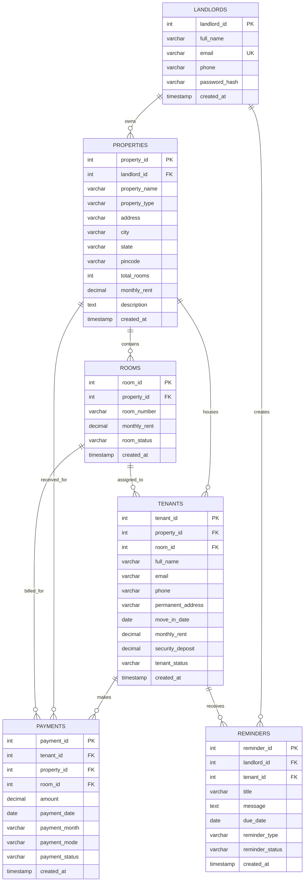

# RentProof Database Architecture & Design Specification

> **Project:** RentProof – Landlord Rental & Property Management System  
> **Database Name:** `rentproof`  
> **Module Lead:** Aditi Sharma (Database, Authentication & Property Management)  
> **Target Audience:** College Project Evaluation, BTech CSE Viva, & Team Integration (Aditi, Shweta, Aanvi, Gungun)

---

## 1. Executive Summary

**RentProof** is a landlord-centric property and rental management platform designed to simplify tracking of properties, individual rooms, tenant occupancy, rental dues, and communication reminders.

This document defines the unified relational database schema for the entire application. The database is hosted on MySQL (using the InnoDB storage engine for ACID compliance and referential integrity) and is shared by all four modules:
1. **Aditi's Module (Core Foundational):** Landlord Authentication, Property Catalog, Room Management, and Shared JDBC Connectivity.
2. **Shweta's Module:** Tenant Onboarding and Lease Management.
3. **Aanvi's Module:** Rental Payments, Receipts, and Financial Tracking.
4. **Gungun's Module:** Automated Alerts, Due Date Reminders, and Maintenance Notices.

---

## 2. Entity-Relationship (ER) Diagram



---

## 3. Data Dictionary (Foundational Schema – Aditi's Ownership)

### 3.1. `landlords` Table
Stores authentication credentials and profile details for registered landlords.

| Column Name | Data Type | Constraints | Description |
| :--- | :--- | :--- | :--- |
| `landlord_id` | `INT` | `PRIMARY KEY, AUTO_INCREMENT` | Unique identifier for each landlord. |
| `full_name` | `VARCHAR(100)` | `NOT NULL` | Landlord's full legal name. |
| `email` | `VARCHAR(100)` | `NOT NULL, UNIQUE` | Registered email (login username). |
| `phone` | `VARCHAR(20)` | `NOT NULL` | Contact telephone/mobile number. |
| `password_hash` | `VARCHAR(255)` | `NOT NULL` | Cryptographic SHA-256 password hash. Never plaintext. |
| `created_at` | `TIMESTAMP` | `DEFAULT CURRENT_TIMESTAMP` | Account creation timestamp. |

- **Indexes:** `idx_landlords_email` on `email` (for sub-millisecond login query performance).

---

### 3.2. `properties` Table
Stores real-estate assets owned by landlords (e.g., PGs, Flats, Apartments, Houses).

| Column Name | Data Type | Constraints | Description |
| :--- | :--- | :--- | :--- |
| `property_id` | `INT` | `PRIMARY KEY, AUTO_INCREMENT` | Unique identifier for each property. |
| `landlord_id` | `INT` | `NOT NULL, FOREIGN KEY` | Owner reference to `landlords(landlord_id)`. |
| `property_name` | `VARCHAR(100)` | `NOT NULL` | Display name (e.g., "Sunrise PG", "Ivory Heights Flat"). |
| `property_type` | `VARCHAR(50)` | `NOT NULL` | Categorization: 'PG', 'Flat', 'Apartment', 'House'. |
| `address` | `VARCHAR(255)` | `NOT NULL` | Street address / plot / locality. |
| `city` | `VARCHAR(50)` | `NOT NULL` | City name (e.g., "Noida", "Jaipur"). |
| `state` | `VARCHAR(50)` | `NOT NULL` | State name (e.g., "Uttar Pradesh"). |
| `pincode` | `VARCHAR(10)` | `NOT NULL` | Postal PIN code (e.g., "201306"). |
| `total_rooms` | `INT` | `NOT NULL, DEFAULT 1` | Total inventory count of rooms/units. |
| `monthly_rent` | `DECIMAL(10,2)`| `NOT NULL, DEFAULT 0.00` | Baseline or total monthly rental price. |
| `description` | `TEXT` | `NULL` | Optional amenities, rules, or details. |
| `created_at` | `TIMESTAMP` | `DEFAULT CURRENT_TIMESTAMP` | Record creation timestamp. |

- **Foreign Key Action:** `ON DELETE RESTRICT ON UPDATE CASCADE`  
  *Justification:* A landlord cannot accidentally delete a property if active rooms, tenants, or payment audit histories are still attached.
- **Indexes:**
  - `idx_properties_landlord` on `landlord_id` (speeds up landlord dashboard property listings).
  - `idx_properties_city` on `city` (speeds up city-wise searches).
  - `idx_properties_type` on `property_type` (speeds up UI filtering).

---

### 3.3. `rooms` Table
Stores individual rental units within a property. This supports multi-room structures such as student PGs, hostels, and shared flats.

| Column Name | Data Type | Constraints | Description |
| :--- | :--- | :--- | :--- |
| `room_id` | `INT` | `PRIMARY KEY, AUTO_INCREMENT` | Unique identifier for each room. |
| `property_id` | `INT` | `NOT NULL, FOREIGN KEY` | Reference to parent `properties(property_id)`. |
| `room_number` | `VARCHAR(20)` | `NOT NULL` | Room label or number (e.g., "101", "Room-A"). |
| `monthly_rent` | `DECIMAL(10,2)`| `NOT NULL, DEFAULT 0.00` | Monthly rent specific to this room. |
| `room_status` | `VARCHAR(20)` | `NOT NULL, DEFAULT 'Vacant'` | 'Vacant', 'Occupied', or 'Maintenance'. |
| `created_at` | `TIMESTAMP` | `DEFAULT CURRENT_TIMESTAMP` | Record creation timestamp. |

- **Composite Unique Constraint:** `uq_property_room UNIQUE (property_id, room_number)`  
  *Justification:* Prevents accidental duplicate room numbers inside the exact same property while allowing different properties to have identical room numbers (e.g., both Property 1 and Property 2 can have Room "101").
- **Foreign Key Action:** `ON DELETE RESTRICT ON UPDATE CASCADE`
- **Indexes:** `idx_rooms_property` on `property_id`, `idx_rooms_status` on `room_status`.

---

## 4. Team Integration Guide & Foreign Key Coordination

To prevent duplicate tables and broken foreign keys, all team members must follow this explicit schema contract:

### 4.1. Shweta's Module – Tenants Management
- **Table Name:** `tenants`
- **Dependencies:**
  1. `property_id INT NOT NULL` -> references `properties(property_id)`
  2. `room_id INT NOT NULL` -> references `rooms(room_id)`
- **Referential Integrity Rule:**
  ```sql
  CONSTRAINT fk_tenants_property 
      FOREIGN KEY (property_id) REFERENCES properties(property_id)
      ON DELETE RESTRICT ON UPDATE CASCADE,
  CONSTRAINT fk_tenants_room 
      FOREIGN KEY (room_id) REFERENCES rooms(room_id)
      ON DELETE RESTRICT ON UPDATE CASCADE
  ```
- **Business Rule:** When Shweta inserts a tenant into a room, update the corresponding `rooms.room_status` from `'Vacant'` to `'Occupied'`. When a tenant moves out, reset the room status to `'Vacant'`.

### 4.2. Aanvi's Module – Rent & Payments
- **Table Name:** `payments`
- **Dependencies:**
  1. `tenant_id INT NOT NULL` -> references `tenants(tenant_id)`
  2. `property_id INT NOT NULL` -> references `properties(property_id)`
  3. `room_id INT NOT NULL` -> references `rooms(room_id)`
- **Referential Integrity Rule:**
  ```sql
  CONSTRAINT fk_payments_tenant 
      FOREIGN KEY (tenant_id) REFERENCES tenants(tenant_id)
      ON DELETE RESTRICT ON UPDATE CASCADE,
  CONSTRAINT fk_payments_property 
      FOREIGN KEY (property_id) REFERENCES properties(property_id)
      ON DELETE RESTRICT ON UPDATE CASCADE
  ```
- **Business Rule:** Never delete payment records. Payments provide financial accountability and tax/accounting audit trails for landlords.

### 4.3. Gungun's Module – Reminders & Notifications
- **Table Name:** `reminders`
- **Dependencies:**
  1. `landlord_id INT NOT NULL` -> references `landlords(landlord_id)`
  2. `tenant_id INT NULL` -> references `tenants(tenant_id)` (Can be NULL for general property maintenance reminders)
- **Referential Integrity Rule:**
  ```sql
  CONSTRAINT fk_reminders_landlord 
      FOREIGN KEY (landlord_id) REFERENCES landlords(landlord_id)
      ON DELETE RESTRICT ON UPDATE CASCADE,
  CONSTRAINT fk_reminders_tenant 
      FOREIGN KEY (tenant_id) REFERENCES tenants(tenant_id)
      ON DELETE SET NULL ON UPDATE CASCADE
  ```

---

## 5. Database Normalization (Viva Defense Points)

For examination and viva questions, this schema follows third normal form (3NF):

1. **First Normal Form (1NF):**
   - Each column stores atomic (indivisible) values.
   - No repeating groups or comma-separated lists of values (e.g., individual rooms are stored in their own `rooms` table rather than a serialized string in `properties`).
   - Every table has a clearly defined Primary Key (`landlord_id`, `property_id`, `room_id`).

2. **Second Normal Form (2NF):**
   - The schema is in 1NF.
   - All non-key attributes are fully functionally dependent on the primary key.
   - In tables with composite business keys (e.g. `(property_id, room_number)`), non-key fields like `room_status` depend on the specific room entity, not partially on `property_id` alone.

3. **Third Normal Form (3NF):**
   - The schema is in 2NF.
   - There are no transitive dependencies (no non-key attribute depends on another non-key attribute). For example, landlord contact details are kept solely in `landlords` rather than replicated in `properties`. Properties reference `landlord_id` as a foreign key.

---

## 6. Safe Database Initialization

`database/rentproof.sql` is non-destructive: it creates missing tables and does not drop tables or delete records. It does not insert sample data. Use `DatabaseInitializer` as the canonical setup because it also applies additive migrations for known legacy columns (landlord password metadata and tenant rent/address fields) without replacing existing rows. It does not attempt to repair arbitrary schema drift.

From the project root on Windows, compile and run the initializer:

```bat
javac -d bin -cp "lib/*;backend\\src\\main\\resources" backend\\src\\main\\java\\com\\rentproof\\database\\DBConnection.java backend\\src\\main\\java\\com\\rentproof\\database\\DatabaseInitializer.java
java -cp "bin;lib/*;backend\\src\\main\\resources" com.rentproof.database.DatabaseInitializer
```

Provide database settings in the ignored `backend/src/main/resources/db.properties`. The initializer uses the credentials there to connect to the MySQL server; it derives a server-level URL from `db.url`, or can use an optional `db.serverUrl` when needed. Keep this file and database backups out of source control. The separate `database/rentproof-sample-data.sql` contains fixed-ID fixtures and should only be used with a verified disposable database.

---

## 7. How Java Connects to MySQL (`DBConnection.java`)

All team members must connect using the single shared class:  
`com.rentproof.database.DBConnection`

```java
try (Connection conn = DBConnection.getConnection();
     PreparedStatement pstmt = conn.prepareStatement("SELECT * FROM properties WHERE landlord_id = ?")) {
    
    pstmt.setInt(1, currentLandlordId);
    try (ResultSet rs = pstmt.executeQuery()) {
        while (rs.next()) {
            // Map ResultSet rows to Java objects
        }
    }
} catch (SQLException e) {
    System.err.println("Database query failed: " + e.getMessage());
}
```

The database credentials (host, port, database name, user, password) are loaded from `db.properties` or system environment variables, keeping sensitive credentials decoupled from source control.
