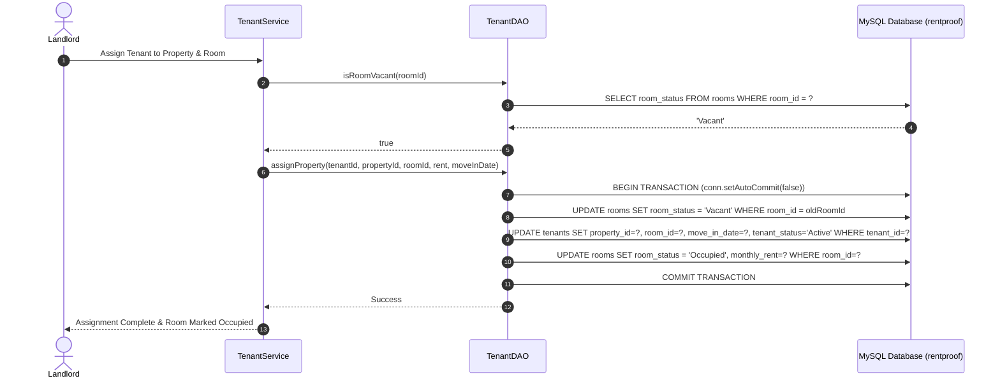

# RentProof – Tenant Management & Property Assignment Module

> **Project:** RentProof – Landlord Rental & Property Management System  
> **Module Lead:** Shweta (Tenant Management & Property Assignment)  
> **Collaborators:** Aditi Sharma (Database, Auth & Properties), Aanvi (Payments), Gungun (Reminders)  
> **Target Evaluation:** BTech CSE 3rd Semester – Programming in Java (Course Code: 25CSE0202, up to Lecture 42)  
> **Theme:** Midnight Blue & Ivory SaaS Property Management Interface  

---

## 1. Module Overview & Scope

The **Tenant Management and Property Assignment Module** is a core operational pillar of **RentProof**, enabling landlords to:
1. **Onboard Tenants:** Capture tenant legal identity, contact numbers, email, emergency contacts, permanent residential address, and security deposits.
2. **Assign Rooms with Availability Enforcement:** Allocate tenants to specific properties and rooms, guaranteeing that **only vacant rooms can be assigned**, preventing double-booking.
3. **Automate Room Occupancy Status:** Synchronize room availability in real time—marking rooms `Occupied` upon active tenant assignment, and restoring them to `Vacant` when a tenant moves out or is deleted.
4. **Manage Lifecycles & Records:** Search by name/phone, filter by property and status (`Active`, `Moved Out`, `Pending`), update contact details, and view complete profile cards.

---

## 2. Technology Stack & Syllabus Compliance (Lecture 1 to 42)

Strictly aligned with the Chitkara University **Programming in Java (25CSE0202)** syllabus up to Lecture 42:

| Layer | Technologies Used | Syllabus Concepts Applied |
| :--- | :--- | :--- |
| **Frontend** | HTML5, CSS3, Vanilla JavaScript | Responsive CSS Grid/Flexbox, DOM manipulation, Regex validation, LocalStorage demonstration fallback, Isolated API client |
| **Backend Model** | Core Java SE (`Tenant.java`) | OOP Encapsulation (private fields, public getters/setters), Multiple Overloaded Constructors, `Comparable<Tenant>` natural sorting, `toString()` |
| **Backend DAO** | Core Java SE (`TenantDAO.java`) | JDBC API (`DriverManager`, `Connection`, `PreparedStatement`, `Statement.RETURN_GENERATED_KEYS`, `ResultSet`), `try-with-resources`, SQL Transactions (`setAutoCommit(false)`, `commit()`, `rollback()`) |
| **Backend Service** | Core Java SE (`TenantService.java`) | Business Validation (10-digit phone regex, email pattern, non-negative amounts), Domain integrity, Collections (`ArrayList`, `Collections.sort()`), Standard loops |
| **Database** | MySQL (InnoDB engine) | Primary keys, Foreign keys, Unique constraints, Transaction ACID properties, 3NF Normalization |

> [!IMPORTANT]
> **Strict Prohibition Observed:** As per course limit (up to Lecture 42), this module does **NOT** use Lambda expressions (`->`), Stream API (`.stream()`), advanced generics/wildcards, Spring Boot, Hibernate, Node.js, React, or Vue. All traversal is implemented with standard Core Java for-loops, iterators, and `Comparable<Tenant>`.

---

## 3. Database Schema & Aditi's Integration Contract

### 3.1. Reusing Shared Database & Connection
In accordance with team rules:
- **No duplicate `DBConnection.java`:** Reuses Aditi's centralized `com.rentproof.database.DBConnection.getConnection()`.
- **No duplicate database:** Connects to the unified `rentproof` database on MySQL.
- **Foreign Key Coordination:** Respects parent tables `properties` and `rooms`.

### 3.2. Data Dictionary for `tenants` Table

```sql
CREATE TABLE IF NOT EXISTS tenants (
    tenant_id INT AUTO_INCREMENT PRIMARY KEY,
    property_id INT NOT NULL,
    room_id INT NOT NULL,
    full_name VARCHAR(100) NOT NULL,
    email VARCHAR(100) NOT NULL,
    phone VARCHAR(20) NOT NULL,
    emergency_contact VARCHAR(20) NULL,
    id_proof_number VARCHAR(50) NULL,
    move_in_date DATE NOT NULL,
    move_out_date DATE NULL,
    security_deposit DECIMAL(10, 2) DEFAULT 0.00,
    tenant_status VARCHAR(20) NOT NULL DEFAULT 'Active', -- 'Active', 'Moved Out', 'Pending'
    created_at TIMESTAMP DEFAULT CURRENT_TIMESTAMP,
    CONSTRAINT fk_tenants_property 
        FOREIGN KEY (property_id) REFERENCES properties(property_id)
        ON DELETE RESTRICT 
        ON UPDATE CASCADE,
    CONSTRAINT fk_tenants_room 
        FOREIGN KEY (room_id) REFERENCES rooms(room_id)
        ON DELETE RESTRICT 
        ON UPDATE CASCADE
) ENGINE=InnoDB DEFAULT CHARSET=utf8mb4 COLLATE=utf8mb4_unicode_ci;

CREATE INDEX idx_tenants_property ON tenants(property_id);
CREATE INDEX idx_tenants_room ON tenants(room_id);
CREATE INDEX idx_tenants_status ON tenants(tenant_status);
```

### 3.3. Referential Integrity & Room Status Coordination



---

## 4. Design System – Midnight Blue & Ivory

The UI conforms strictly to the specified RentProof color palette:

| Token Name | Hex Code | Visual Application in Module |
| :--- | :--- | :--- |
| **Navy** | `#26364A` | Sidebar, primary action buttons, table headers, stat card values |
| **Steel Blue** | `#526B82` | Action icon badges, active links, section divider titles |
| **Ivory** | `#F5F2EB` | Main canvas background, modal headers, card hover surfaces |
| **Sand** | `#C6B99F` | Border accents, warm highlighted badges, avatar borders |
| **Slate** | `#344454` | Typography, data table text, contrast card headers |

---

## 5. File Structure & Deliverables

```
RentProof/
├── backend/
│   └── src/
│       └── main/
│           └── java/
│               └── com/
│                   └── rentproof/
│                       └── tenant/
│                           ├── Tenant.java          # Model class with encapsulation & Comparable
│                           ├── TenantDAO.java       # JDBC CRUD operations with PreparedStatement
│                           └── TenantService.java   # Business logic, validations & vacancy enforcement
├── frontend/
│   └── tenants/
│       ├── tenants.html          # Main Tenant Management Dashboard with stats & filters
│       ├── add-tenant.html       # Tenant registration form with dynamic room dropdown
│       ├── edit-tenant.html      # Tenant profile editor with occupancy sync
│       ├── assign-property.html  # Dedicated room assignment page with vacancy check
│       ├── tenants.css           # Midnight Blue & Ivory design system stylesheet
│       └── tenants.js            # Modular reactive UI controller & isolated TenantAPI
└── docs/
    └── tenant-module-notes.md    # Comprehensive technical & viva documentation
```

---

## 6. Frontend & Backend Integration Architecture

1. **Isolated API Layer (`TenantAPI`):**  
   All network requests are encapsulated in the `TenantAPI` object inside `tenants.js`. This allows the frontend to toggle seamlessly between:
   - **Local Demonstration Mode:** Stores records in browser `localStorage`, pre-seeded with Aditi's `database/rentproof.sql` sample records.
   - **Live Backend Mode:** Connects via RESTful JSON HTTP endpoints (`GET /api/tenants`, `POST /api/tenants`, etc.) when Java servlets or micro-handlers are deployed.
2. **Dynamic Room Dropdown:**  
   When a landlord selects a property on `add-tenant.html` or `assign-property.html`, the system filters the room inventory and displays **strictly vacant rooms**. If a property has no vacant rooms, the room selector is disabled with a clear warning: *"No vacant rooms available in this property"*.
3. **Real-time Occupancy Synchronization:**  
   When a tenant's status is changed to `Moved Out` or a tenant record is deleted, their assigned room status is immediately reset to `Vacant`.

---

## 7. Viva Defense & Faculty Examination Q&A

### Q1: Why did you implement `Comparable<Tenant>` in `Tenant.java`?
**Answer:**  
In Lecture 23-25 of our Java syllabus, we covered sorting collections using natural ordering (`Comparable`) and custom ordering (`Comparator`). By having `Tenant` implement `Comparable<Tenant>` and overriding `compareTo(Tenant other)`, we define a natural alphabetical sorting by the tenant's full name. This enables simple, clean sorting using `Collections.sort(tenantList)` in `TenantService` without requiring lambda expressions.

### Q2: Why did you use `PreparedStatement` instead of `Statement` in `TenantDAO`?
**Answer:**  
1. **Security (SQL Injection Defense):** `PreparedStatement` uses parameterized `?` placeholders. User input (e.g. tenant names, emails) is pre-compiled and treated strictly as data, preventing attackers from injecting malicious SQL commands.  
2. **Performance:** The database compiles and caches the query execution plan once, making repeated queries significantly faster.

### Q3: How do you handle database resource leaks?
**Answer:**  
We utilize the **try-with-resources** statement introduced in Java 7 (Lectures 10-12, 37-39). Any class implementing `AutoCloseable` (such as `Connection`, `PreparedStatement`, and `ResultSet`) declared within the `try (...)` parentheses is automatically closed when execution leaves the block, even if a `SQLException` occurs.

### Q4: Why are database transactions used in `assignProperty` and `addTenant`?
**Answer:**  
A room assignment requires two related database operations:
1. Updating or inserting the tenant record in the `tenants` table.
2. Updating the room status to `'Occupied'` in the `rooms` table.
If the second update fails, the database would be in an inconsistent state (a tenant assigned to a room that still appears vacant). By disabling auto-commit (`conn.setAutoCommit(false)`), executing both statements, and calling `conn.commit()` only when both succeed (with `conn.rollback()` in the `catch` block), we guarantee **Atomicity** (the 'A' in ACID).

### Q5: How does this module enforce relational normalization?
**Answer:**  
The design adheres strictly to **Third Normal Form (3NF)**:
- **1NF:** Each column stores atomic values (no comma-separated phone numbers or room numbers).
- **2NF:** All non-key attributes depend on the entire primary key (`tenant_id`).
- **3NF:** No transitive dependencies. Property details (name, city, address) and room details (room number, baseline rent) are stored in `properties` and `rooms` tables, respectively. The `tenants` table references them strictly via foreign keys (`property_id`, `room_id`).

---

## 8. Verification & Integration Checklist

- [x] Java classes compile cleanly with zero errors (`javac` using JDK 17/21).
- [x] All 10 required files created and named exactly as specified.
- [x] Strict adherence to Lecture 1–42 syllabus (no lambdas, no streams, simple OOP loops).
- [x] Midnight Blue & Ivory color scheme applied throughout all views.
- [x] Real-time search, dual filtering (property + status), and summary stats cards active.
- [x] Dynamic room selector ensures only vacant rooms can be assigned.
- [x] Form validations (phone 10-digit, email RFC format, non-negative rent/deposit) active.
- [x] Clean, isolated API layer with demonstration mode matching `rentproof.sql`.
- [x] Individual file-by-file Git commits performed on `shweta` branch.
